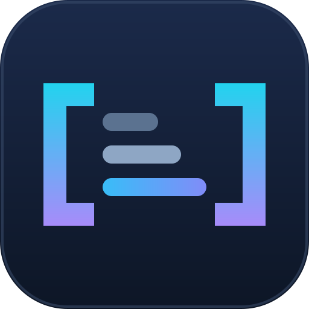

# Model Context Windows for CLIProxyAPI



[简体中文](README.zh-CN.md)

A small C ABI v1 response-interceptor plugin that adds configured `context_length`
values to OpenAI-shaped model lists. It does not discover model capabilities,
change token limits, or modify inference requests. No third-party Go dependencies.

This is an independent community project, not an official CLIProxyAPI component
or an endorsement by its maintainers.

For a configured fictional model `example-small: 32768`, the model entry becomes:

```json
{"id":"example-small","object":"model","context_length":32768}
```

This number is supplied by the operator, not measured or guaranteed by the plugin.

## Requirements and compatibility

- A Linux CLIProxyAPI host with the **C ABI v1 response-interceptor plugin API**.
  A generic OpenAI-compatible server is not sufficient.
- Build: Go 1.26, a C compiler, and libc development headers (`cgo`).
- Test harness: Python 3 (standard library only).
- Build for the host's architecture and compatible libc. This is not a portable
  binary across operating systems or libc implementations.

ABI declarations were checked against upstream source commit
`556f50aa2adf4075303e82ccf6355efc06d3f2df` (v7-module source baseline).
Version 1.1.1 was built and tested with Go 1.26.5/GCC 12 on Linux amd64
(Debian 12, glibc), then loaded into an isolated CLIProxyAPI v8.0.23 host
(commit `d318bcc`). With a fictional provider, `/v1/models` returned the
configured `context_length: 32768`. This is a focused integration check, not a
guarantee for all host versions, architectures, providers, or clients.

## Build and test

```sh
go test ./...
sh build.sh
python3 harness.py dist/models-context-v1.1.1.so
```

`build.sh` builds in the foreground and writes a versioned `.so` plus the generated
C header under `dist/`. It does not install, start a container, or reload a host.
Optional normal Docker build (requires Docker and the image; may pull it):

```sh
docker run --rm -v "$PWD:/src" -w /src golang:1.26-bookworm sh -c 'go test ./... && sh build.sh'
```

This only builds files in the mounted checkout. Run the harness in an environment
whose architecture/libc can load the resulting library.

Optional isolated host test after building (requires an already available host
image with `./CLIProxyAPI` and the `-local-model` flag):

```sh
python3 tests/integration.py "$PWD" YOUR_LOCAL_CPA_IMAGE_ID
```

The test writes dummy-only `integration-config.yaml` and `integration-plugins/`
in the checkout, starts a separate container on a random loopback port, checks
`example-model` reports `context_length: 32768`, and removes the test container.
It never reads production config or invokes inference. Use a disposable checkout;
the generated files are ignored by Git. The image is not pulled automatically.
The host process may still make background network requests (for example, for
updates or metadata); this integration test is not network-isolated. The plugin
itself performs no network access. Both Python test scripts require assertions
and reject `-O`, `-OO`, or `PYTHONOPTIMIZE`.

## Installation and configuration

1. Build and run the offline tests above.
2. Follow your host version's plugin-directory and enablement instructions.
   Copy the library into that directory **renamed to `models-context.so`** so the
   plugin ID matches the configuration key. The versioned filename is a build
   artifact, not a cross-version host discovery guarantee.
3. Move old versions outside the scanned directory (avoid duplicate candidates).
   Restart the host according to its documentation; do not assume hot reload.
4. Request `/v1/models` and check the configured model's `context_length`.

Example host configuration (fictional IDs; adjust to your actual model IDs):

```yaml
plugins:
  enabled: true
  configs:
    models-context:
      enabled: true
      priority: 1
      context_lengths:
        example-small: 32768
        example-large: 131072
        "example:local": 8192
```

The host sends this plugin's configuration block as base64-encoded `config_yaml`
in the lifecycle JSON envelope. Legacy `ConfigYAML` spellings are accepted.
Token counts must be positive decimal integers, optionally quoted. **No K/M
suffixes, hyphenated `context-lengths`, YAML anchors, or general YAML parser.**
Non-ASCII YAML `\xHH` escapes (above `\x7F`, such as `\x80` or `\xE9`) are
unsupported and rejected, not decoded as raw bytes. Use literal Unicode or
`\u`/`\U` escapes instead; ASCII `\xHH` escapes are supported.
Supported normalized forms are the indented mapping above and inline JSON:

```yaml
context_lengths: '{"example-small":32768}'
# context_lengths_json is also accepted for inline JSON.
```

## Behavior and limitations

- Exact, case-sensitive ID lookup; no family matching or automatic verification.
- Only non-streaming 2xx responses without execution model fields are eligible.
  Each nonempty `data` entry must have a nonblank string `id` and `object: model`.
  The top-level `object` must be `list` or absent/empty.
- Preserves positive numeric upstream `context_length` values (including numeric
  strings). Missing, zero, negative, or invalid values can be filled from config.
- Unmapped models stay unchanged. Unknown JSON fields and integer precision are
  retained; rewritten JSON formatting/key order may change. A no-op returns an
  empty interceptor result and leaves the original body to the host.
- The ABI does not provide a route check here: another endpoint returning the
  same model-list shape could be intercepted. This is deliberately conservative
  shape detection, not proof that a request was `/v1/models`.
- Malformed/absent lifecycle config clears old mappings; malformed entries are
  ignored. An empty mapping is a no-op. The parser supports a restricted host-
  normalized YAML subset, not arbitrary YAML.
- No diagnostic probe, response logging, host callbacks, or network access.
  The plugin does not validate your configured token counts against a provider.

## Test scope

Go tests cover list detection, preservation, injection rules, exclusions, config
forms and stale-state clearing. The ctypes harness loads the actual shared library
and checks the ABI handshake, envelopes, buffer/free paths, metadata, lifecycle
calls and representative response fixtures. These are **offline tests**, not a
full host integration, concurrency stress test, security audit, client compatibility
matrix, or proof of provider context capacity. Invalid non-null C pointers cannot
be safely validated; the host must obey the ABI and own input-buffer lifetimes.

See [CONTRIBUTING](CONTRIBUTING.md), [SECURITY](SECURITY.md),
[CHANGELOG](CHANGELOG.md), and [third-party notices](THIRD_PARTY_NOTICES.md).
Licensed under [MIT](LICENSE).
